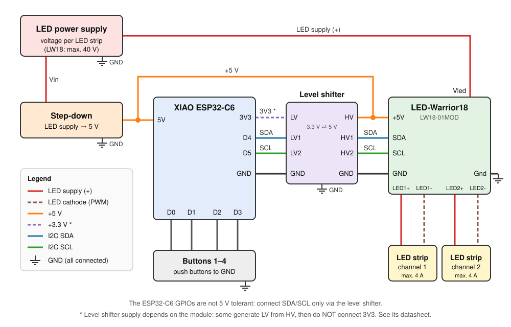

# lw18-esp32c6-z2m - LED-Warrior18 dimmer with ESP32-C6 for Zigbee2MQTT
Firmware for a dual-channel LED dimmer with four local push buttons, built from a LED-Warrior18 module and a Seeed Studio XIAO ESP32-C6. The device joins a Zigbee network as a router and is controlled via Zigbee2MQTT and Home Assistant.

This is example code showing how to use the LED-Warrior18 in a home automation setup. It is not a certified product.


## What is a LED-Warrior18
The LED-Warrior18 (LW18) is an I2C controlled dual PWM LED driver with 2 x 16 bit PWM, up to 4 A per channel and LED supply voltages up to 40 V.
For more detailed information please visit the [company site](https://www.codemercs.com) or read the [LW18 datasheet](https://files.codemercs.com/ledwarrior/LW18_Datasheet.pdf).


## Features
- 2 light channels (LW18 channel 1 and 2): on/off, brightness, smooth fading, gamma curve, light effects
- Switch "sync": both channels follow each slider (default), or both channels are controlled independently
- 4 push buttons: `single`, `double`, `hold` and `release` events are sent to Zigbee2MQTT as `action`
- Switch "local control": the buttons also control the light directly, so the light keeps working without Home Assistant
- Configurable fade time and power-on behavior (`off`, `on`, `toggle`, `previous`)
- On/off state and brightness are restored after a power failure
- LW18 supervision: the I2C bus is recovered and the LW18 is re-initialized after errors or a LW18 restart


## Hardware

| Component | Type | Note |
| ----------- | ----------- | ----------- |
| MCU | Seeed Studio XIAO ESP32-C6 | IEEE 802.15.4 radio, 4 MB flash |
| LED driver | Code Mercenaries LED-Warrior18 module (LW18-01MOD) | I2C, 2 x 16 bit PWM |
| Level shifter | I2C level shifter 3.3 V <-> 5 V, bidirectional, 2 channels | **required**, see below |
| LED power supply | DC voltage based on the LED strip (e.g. 12 V or 24 V) | LW18 limits: max. 40 V LED voltage, max. 4 A per channel. Size the supply for the total current of both strips |
| Step-down converter | LED supply voltage -> 5 V | for XIAO and LW18 logic (XIAO + LW18 logic need well below 0.5 A). The input range must cover the LED supply voltage |
| Buttons | 4 x push button (normally open, low voltage) | to GND, internal pull-up |


### Pin assignment XIAO ESP32-C6

| Function | XIAO pin | GPIO |
| ----------- | ----------- | ----------- |
| Button 1 | D0 | GPIO0 |
| Button 2 | D1 | GPIO1 |
| Button 3 | D2 | GPIO2 |
| Button 4 | D3 | GPIO21 |
| I2C SDA (via level shifter) | D4 | GPIO22 |
| I2C SCL (via level shifter) | D5 | GPIO23 |
| Factory reset (BOOT button, onboard) | - | GPIO9 |
| Status LED (onboard, active low) | - | GPIO15 |


### Wiring


<details>
<summary>Wiring as text</summary>

```
LED supply (+) ──┬────────────────── LW18 Vled ── LED1+/LED2+ (strip anodes)
                 │                   LW18 LED1- / LED2- ── strip cathodes
                 └── 5 V step-down Vin
                     step-down Vout (5 V) ──┬── XIAO 5V
                                            └── LW18 +5V (logic)
GND ── common ground: power supply, step-down, XIAO, LW18, level shifter, buttons

XIAO 3V3 ── level shifter LV (*)    LW18 +5V ── level shifter HV
XIAO D4 (GPIO22, SDA) ── LV1 <-> HV1 ── LW18 SDA
XIAO D5 (GPIO23, SCL) ── LV2 <-> HV2 ── LW18 SCL

XIAO D0..D3 ── button 1..4 ── GND

(*) depends on the level shifter module, see the notes below
```
</details>


### Important hardware notes
- **Level shifter:** The LW18 has internal pull-ups to 5 V. The GPIOs of the ESP32-C6 are **not 5 V tolerant**. Connect SDA/SCL only via a level shifter. Do not swap the LV and HV side.
- **Level shifter supply:** Level shifter modules differ. The diagram shows a module that needs both supplies (LV = 3.3 V from the XIAO, HV = 5 V). Some modules generate the low voltage side themselves from HV, in this case the XIAO 3V3 **must not** be connected to LV. Always wire the level shifter according to the datasheet of the module you use.
- **Buttons:** Use low voltage push buttons only, never connect mains switches. For longer cables (> 1 m) add an RC filter per input (1 kOhm in series, 100 nF to GND).
- **USB and external 5 V:** Check the XIAO schematic before connecting USB and an external 5 V supply at the same time. If in doubt, disconnect the external 5 V supply while flashing.


## Building and flashing
The project uses [PlatformIO](https://platformio.org/) with the [pioarduino](https://github.com/pioarduino/platform-espressif32) platform (Arduino core 3.3.x, required for the Zigbee multistate endpoints).

Use VS Code with the **pioarduino IDE** extension, or the command line:
```
pio run -t upload
```

Pins, timings, button mapping and light effects are defined in [include/config.h](include/config.h).


### PWM frequency
The LW18 runs with 730 Hz PWM at full 16 bit resolution by default. This firmware sets a higher frequency to avoid visible flicker and camera banding: period register `n = 16383` -> **about 2.9 kHz at 14 bit** resolution.

The frequency is `48 MHz / (n + 1)` and can be changed in [include/config.h](include/config.h):
```cpp
constexpr uint16_t lw18PeriodReg = 16383;  // 48 MHz / (n + 1)
```

| `lw18PeriodReg` | PWM frequency | Resolution |
| ----------- | ----------- | ----------- |
| 65535 | 730 Hz (LW18 default) | 16 bit |
| 32767 | 1.46 kHz | 15 bit |
| 16383 | 2.93 kHz (this firmware) | 14 bit |
| 8191 | 5.86 kHz | 13 bit |

Brightness and fading scale automatically. Lower resolution means coarser steps at very low brightness. The period is not stored in the LW18, the firmware sets it after every start and checks it during operation.
On Windows, build from PowerShell or the IDE, not from Git Bash/MSYS (`idf_tools.py` refuses to run there).


## Pairing
1. Enable "Permit join" in Zigbee2MQTT.
2. Power the device. The status LED blinks until the device has joined the network.
3. Factory reset (e.g. to join a different network): hold the BOOT button for more than 3 s.


## Zigbee2MQTT external converter
Without the converter Zigbee2MQTT only detects a generic light. Buttons, switches and effects need the converter.

1. Copy [z2m/lw18_dimmer_4t.mjs](z2m/lw18_dimmer_4t.mjs) to `<zigbee2mqtt data>/external_converters/` (Home Assistant add-on: usually `/config/zigbee2mqtt/external_converters/`).
2. Restart Zigbee2MQTT.
3. If the device was paired before: run "Interview" and then "Reconfigure" on the device page.

Tested with Zigbee2MQTT 2.14.3.


### Endpoints and exposes

| Endpoint | Name | Function |
| ----------- | ----------- | ----------- |
| 10 | `light` | Channel 1 (on/off, brightness, effect), plus fade time and power-on behavior for both channels |
| 11 - 14 | `button_1` ... `button_4` | Buttons (multistate input) |
| 15 | `local` | Switch "local control" |
| 16 | `light_2` | Channel 2 (on/off, brightness, effect) |
| 17 | `sync` | Switch "channels in sync" |

`action` values: `button_<1..4>_<single|double|hold|release>`, e.g. `button_1_hold`. Home Assistant shows them as device triggers for automations.


### Example automation
Buttons 2 to 4 have no local function by default, so they are free for Home Assistant automations. This example toggles channel 2 with a short press on button 2 and switches both channels off with a double press. Replace `<device>` with the friendly name of the device in Zigbee2MQTT and adjust the entity IDs.

```yaml
alias: LW18 button 2
mode: queued
triggers:
  - trigger: mqtt
    topic: zigbee2mqtt/<device>
    value_template: "{{ value_json.action }}"
    payload: button_2_single
    id: single
  - trigger: mqtt
    topic: zigbee2mqtt/<device>
    value_template: "{{ value_json.action }}"
    payload: button_2_double
    id: double
actions:
  - choose:
      - conditions:
          - condition: trigger
            id: single
        sequence:
          - action: light.toggle
            target:
              entity_id: light.<device>_light_2
      - conditions:
          - condition: trigger
            id: double
        sequence:
          - action: light.turn_off
            target:
              entity_id:
                - light.<device>_light
                - light.<device>_light_2
```

The same triggers are also available in the automation editor as device triggers ("Device" -> your device -> e.g. "button_2_single").


### Buttons and local control
With "local control" switched on, button 1 controls the light directly: short press = on/off, double press = 100 %, hold = dim (direction changes with every hold).
The actions and the channels each button controls (`ChannelSelect::ch1`, `ch2` or `both`) are set in `localActions` in [include/config.h](include/config.h). In sync mode a button always controls both channels.


### Fade time
Expose `fade_time_light` (seconds, 0 = switch instantly, max. 60 s, default 0.4 s), Zigbee attribute `genLevelCtrl.onOffTransitionTime`. It applies to on/off commands and to the buttons and is kept after a restart.

The fade time does **not** apply to brightness changes. A brightness command carries its own transition time. Zigbee2MQTT sends 0 if none is given, so the brightness changes instantly. For smooth dimming with the slider use:
- per command: `{"brightness": 200, "transition": 5}` or `light.turn_on` with `transition` in Home Assistant
- as default: Zigbee2MQTT -> device -> settings (specific) -> "Transition"


### Light effects
Expose `effect` (in Home Assistant: effect list of the light entity). After an effect the light returns to its previous state.

| Effect | Sequence |
| ----------- | ----------- |
| `blink` | 1 x 0.5 s on / 0.5 s off |
| `breathe` | 15 x smooth up/down (0.5 s each) |
| `okay` | 2 x short blink |
| `channel_change` | 0.5 s full, 7.5 s minimum |
| `pulse_fast` | 5 x up in 1 s, down in 0.5 s |
| `pulse_slow` | 5 x up in 2 s, down in 2 s |
| `alarm` | fast blinking (250 ms) until stopped, stops after 5 min at the latest |
| `finish_effect` / `stop_effect` | stop after the current cycle / stop immediately |

Switching off and pressing a button also stop an effect.

In Home Assistant `light.turn_on` with `effect` also switches the light on. To return to "off" after the effect (e.g. as a door bell signal), send the effect via MQTT:
```yaml
action: mqtt.publish
data:
  topic: zigbee2mqtt/<device>/set
  payload: '{"effect": "pulse_fast"}'
```

New effects are added in `lightEffects` in [include/config.h](include/config.h) and in the converter with the same ID.


## Serial console
USB serial with 115200 baud. Type `help` for a list of commands, e.g. `scan` (I2C scan), `read` (read PWM registers), `fx <name>` (start an effect) or `zb` (Zigbee and light status).

The console is meant for setup and diagnostics. It can be disabled with `enableSerialConsole = false` in [include/config.h](include/config.h), the commands are then not compiled in. Log output stays active, it is discarded when no USB host is connected.


## Versions

| Version | Date | Changes |
| ----------- | ----------- | ----------- |
| 1.0.0.0 | 2026-11-17 | Initial version |

The version is defined in [include/config.h](include/config.h) (`firmwareVersion`) and shown by Zigbee2MQTT as firmware version of the device.


# Using 3rd party API and toolchains
This project uses 3rd party software. Please take care about the license of each component. None of them is included in this repository, PlatformIO downloads them during the build.

| Component | License |
| ----------- | ----------- |
| [Arduino core for ESP32](https://github.com/espressif/arduino-esp32) | LGPL-2.1, parts Apache-2.0 |
| [ESP Zigbee SDK](https://github.com/espressif/esp-zigbee-sdk) (esp-zigbee-lib) | Apache-2.0 |
| ZBOSS Zigbee stack (esp-zboss-lib, binary only) | DSR Corporation / Espressif license, see the library headers |
| [Button2](https://github.com/LennartHennigs/Button2) | MIT |
| [zigbee-herdsman-converters](https://github.com/Koenkk/zigbee-herdsman-converters) (used by the converter) | MIT |


## Zigbee
Zigbee is a trademark of the [Connectivity Standards Alliance](https://csa-iot.org/). This project uses the Zigbee protocol via the [ESP Zigbee SDK](https://github.com/espressif/esp-zigbee-sdk) from Espressif. It is not a certified product and is not affiliated with or endorsed by the Connectivity Standards Alliance.


## Development
This code was developed with the help of [Claude Code](https://claude.com/claude-code) (Anthropic) and tested on real hardware.


## Links and further information
[Company site](https://www.codemercs.com) for information on the LED-Warrior18 and more devices.  
[LW18 datasheet](https://files.codemercs.com/ledwarrior/LW18_Datasheet.pdf) (PDF)  
[Zigbee2MQTT](https://www.zigbee2mqtt.io/) documentation.


## Contact
If you have any questions about the LED-Warrior18 please contact **support@codemercs.com** or use the [issues](https://github.com/codemercs-com/lw18-esp32c6-z2m/issues) section in this repository. There is also a company [forum](https://forum.codemercs.com/) with many solved questions.


## License
MIT, see [LICENSE](LICENSE). Copyright (c) 2026 Code Mercenaries Hard- und Software GmbH.
